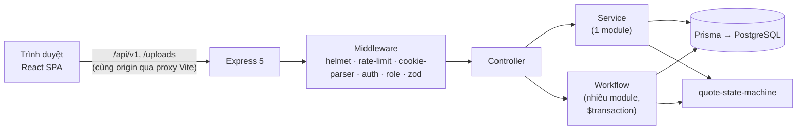

# 01. Kiến trúc hệ thống & Giải pháp kỹ thuật

## 1. Kiến trúc tổng thể

Hệ thống theo mô hình Client–Server tách biệt (RESTful JSON API). Backend tổ chức theo **Modular Architecture phẳng** kết hợp **`workflows/`** cho giao dịch đa bảng và **State Machine** riêng cho nghiệp vụ báo giá. Không tạo lớp `repository` bọc thừa trên Prisma (Prisma đã là Data Mapper), nhờ đó gọn trên JavaScript thuần mà vẫn cô lập phạm vi code cho 3 thành viên.



### Chuẩn kỹ thuật chung (ghi rõ để cả nhóm không lệch)

| Hạng mục | Quyết định |
| :--- | :--- |
| Node.js | **22 LTS** |
| Express | **5.x** (`express@5`): handler `async` ném lỗi tự chuyển vào error middleware, **không cần** `asyncHandler` |
| Module system | **ESM** (`"type": "module"`), import tương đối **có đuôi `.js`** |
| Prisma | Ghim **`prisma@6` và `@prisma/client@6`**, commit `package-lock.json`. Không dùng Prisma 7+ |
| Validation & CSS | Ghim **`zod@3`** (nhưng `validate.middleware.js` luôn đọc `err.issues`) và **`tailwindcss@3`** (dùng `tailwind.config.js`) |
| Định dạng code | ESLint + Prettier **cấu hình chung ở gốc repo**, `husky` + `lint-staged` chạy khi commit |
| Ngôn ngữ comment | Tiếng Việt; tên định danh tiếng Anh |

### Cấu trúc thư mục Backend (`backend/`)

```text
backend/
├── prisma/
│   ├── schema.prisma
│   ├── seed.js                           # Tạo dữ liệu mẫu idempotent, chạy ảnh seed qua sharp
│   └── seed-assets/                      # Ảnh gốc dùng cho seed (COMMIT vào git, uploads/ thì không)
│
├── src/
│   ├── config/
│   │   └── env.js                        # Validate biến môi trường bằng Zod, thiếu/sai là thoát ngay
│   │
│   ├── common/
│   │   ├── errors/
│   │   │   └── AppError.js               # AppError, BadRequestError, UnauthorizedError, ForbiddenError, NotFoundError, ConflictError
│   │   ├── middleware/
│   │   │   ├── auth.middleware.js        # Đọc cookie JWT + kiểm tra User.status === 'ACTIVE' trong DB
│   │   │   ├── role.middleware.js        # requireRole(...roles)
│   │   │   ├── validate.middleware.js    # validate({ params?, query?, body? }) -> ghi req.valid
│   │   │   ├── rate-limit.middleware.js  # Giới hạn /auth/login (skipSuccessfulRequests) & /auth/register
│   │   │   └── error.middleware.js       # Map AppError, MulterError, SyntaxError, Prisma P2002/P2025/P2003
│   │   ├── utils/
│   │   │   ├── response.util.js          # ok(res, data, meta?, status=200)
│   │   │   ├── slug.util.js              # toSlug(text), uniqueSlug(text, existsFn)
│   │   │   ├── jwt.util.js               # signToken, verifyToken
│   │   │   ├── image.util.js             # thumbOf(url)
│   │   │   └── ownership.util.js         # assertOwner(condition) -> throw NotFoundError()
│   │   └── constants/
│   │       ├── roles.js                  # ROLES, USER_STATUS
│   │       └── quote-status.js           # QUOTE_STATUS, BID_STATUS
│   │
│   ├── infrastructure/
│   │   ├── database/
│   │   │   └── prisma.client.js          # Singleton PrismaClient
│   │   ├── storage/
│   │   │   └── image.service.js          # Multer + Sharp kiểm format & nén .webp: thumb (400px) & full (1200px)
│   │   └── qr/
│   │       └── qr.service.js             # Sinh QR động (DataURL) từ FRONTEND_URL + batchCode
│   │
│   ├── modules/
│   │   ├── auth/            (auth.{routes,controller,service,validator}.js)
│   │   ├── artisans/        (artisans.{routes,controller,service,validator}.js)
│   │   ├── catalog/         (catalog.{routes,controller,service,validator}.js)
│   │   ├── batches/         (batches.{routes,controller,service,validator}.js)
│   │   ├── quotes/          (quotes.{routes,controller,service,validator}.js · quote-state-machine.js · quote.presenter.js)
│   │   ├── media/           (media.{routes,controller}.js)
│   │   ├── news/            (news.{routes,controller,service,validator}.js)
│   │   └── admin/           (admin.{routes,controller,service,validator}.js)
│   │
│   ├── workflows/                        # Điều phối giao dịch đa module bằng prisma.$transaction
│   │   ├── register-artisan.workflow.js  # Tạo đồng thời User (PENDING) + ArtisanProfile
│   │   ├── send-quote.workflow.js        # Lọc hộ ACTIVE phù hợp -> tạo QuoteInvitation
│   │   └── accept-quote.workflow.js      # Khoá đơn + validate phân bổ + chốt
│   │
│   ├── routes.js                         # Mount 8 router vào /api/v1
│   ├── app.js                            # Express, helmet, cookie-parser, static /uploads, routes, error handler
│   └── server.js                         # Khởi chạy HTTP server
│
├── tests/                                # node:test
│   ├── unit/                             # Thuần logic, chạy bằng npm run test:unit (không cần DB)
│   │   ├── slug.test.js                  # Test chuyển đổi slug tiếng Việt, cấm 'me', fallback 'item'
│   │   ├── image.test.js                 # Test hàm thumbOf
│   │   ├── ownership.test.js             # Test assertOwner ném 404
│   │   ├── errors.test.js                # Test các lớp AppError và mã HTTP
│   │   └── quote-state-machine.test.js   # State machine & validateAllocations (TV3 thực hiện khi làm module quotes)
│   ├── integration/                      # Kiểm thử tích hợp khởi động app/routes
│   │   └── app-framework.test.js
│   └── quote-concurrency.test.js         # Promise.all trên DB vcraft_test (npm test)
├── uploads/                              # Ảnh thực tế (thumb/ và full/, .gitignore)
├── package.json
└── .env.example
```

### Quy tắc phụ thuộc, an ninh & mẫu thiết kế ở Backend
1. **Luồng một chiều:** `Route` → `Middleware (rate-limit/Auth/Role/Zod)` → `Controller` → `Service` (một module) hoặc `Workflow` (nhiều module) → `Prisma Client`. Controller chỉ đọc `req.valid`, gọi service/workflow và trả JSON chuẩn qua `ok()`, không chứa nghiệp vụ.
2. **Không import chéo giữa các `*.service.js`.** Service **được** đọc bảng của miền khác trực tiếp bằng Prisma (VD `catalog` kiểm tra lô thuộc xưởng mình). Thao tác **ghi** xuyên từ 2 miền trở lên đặt trong `src/workflows/` và chạy trong `prisma.$transaction`.
3. **Single Source of Truth cho State Machine & Presenter:** `quotes.service.js`, `send-quote.workflow.js`, `accept-quote.workflow.js` đều dùng hàm kiểm tra chuyển trạng thái của `src/modules/quotes/quote-state-machine.js` và dựng dữ liệu trả về qua `src/modules/quotes/quote.presenter.js`.
4. **Kiểm tra tài khoản trên từng request (`auth.middleware.js`):** đọc JWT từ cookie, giải mã, rồi truy vấn `User` theo `id` (kèm `artisanProfile.id` nếu là `ARTISAN`) để chắc `status === 'ACTIVE'`. Tài khoản vừa bị `SUSPENDED` bị chặn ngay với `403` dù cookie còn hạn.
5. **Chống IDOR:** middleware chỉ kiểm tra `role`. Service/workflow dùng `assertOwner()` đối chiếu quyền sở hữu (`product.artisanId`, `batch.artisanId`, `quote.buyerId`, `bid.artisanId`) trước mọi thao tác nhạy cảm; **sai thì trả `404`**.
6. **Mẫu thiết kế cốt lõi (dùng khi vấn đáp):** Modular Service Layer; Workflow Orchestration; State Machine; Presenter; Singleton (`prisma.client.js`); Data Mapper/ORM (Prisma: thao tác CSDL hướng đối tượng, độc lập hệ quản trị).


### Cấu trúc thư mục Frontend (`frontend/`)

Áp dụng **Feature-based Architecture** để 3 thành viên làm giao diện song song, ít xung đột file.

```text
frontend/
├── vite.config.js                        # server.host = true + proxy /api, /uploads -> http://localhost:5000
├── tailwind.config.js                    # Khai báo design tokens (clay, celadon, paper, ink, gold, font)
├── public/
└── src/
    ├── app/
    │   ├── router/
    │   │   ├── index.jsx                 # URL sạch (/artisans/:slug, /products/:slug, /trace/:batchCode)
    │   │   └── ProtectedRoute.jsx        # Chặn route theo đăng nhập và Role
    │   ├── providers/
    │   │   └── AuthProvider.jsx          # Gọi /auth/me khi tải trang để khôi phục phiên (401 -> user = null, không redirect)
    │   └── layouts/
    │       ├── PublicLayout.jsx          # Header, Footer mang bản sắc làng nghề
    │       └── DashboardLayout.jsx       # Sidebar cho Buyer / Artisan / Admin
    ├── features/
    │   ├── auth/                         # Đăng nhập, Đăng ký (Buyer & Artisan kèm form xưởng)
    │   ├── artisans/                     # Danh sách xưởng, Hồ sơ xưởng, Bản đồ Leaflet, Sửa hồ sơ xưởng
    │   ├── catalog/                      # Trang chủ Triển lãm số, Danh mục/lọc, Chi tiết & CRUD sản phẩm
    │   ├── batches/                      # Quản lý Lô & Nhật ký, Modal xem/tải QR, Landing /trace/:batchCode
    │   ├── quotes/                       # Tạo & phân bổ (Buyer), Chào giá & tiến độ (Artisan), Giám sát (Admin)
    │   └── community/                    # Bảng tin cộng đồng (Modal/Accordion), Admin duyệt hộ & CRUD tin
    ├── components/
    │   ├── ui/                           # Button, Input, Modal, Badge, Spinner, Toast
    │   └── shared/                       # ImageUploader, Pagination, ConfirmDialog, ImageWithFallback
    ├── api/
    │   ├── client.js                     # Axios: baseURL '/api/v1'; 401 (trừ /auth/me, /auth/login) -> clearAuth; 409 -> toast
    │   └── *.api.js                      # Một file mỗi module (auth, artisans, catalog, batches, quotes, news, admin, media)
    ├── hooks/                            # useDebounce, usePagination
    ├── utils/                            # formatCurrency, formatDate, thumbOf
    └── main.jsx
```


## 2. Phiên đăng nhập & bảo mật

| Hạng mục | Cách làm |
| :--- | :--- |
| Mật khẩu | `bcrypt` (cost ≥ 10); chính sách ≥ 8 ký tự khi đăng ký |
| Phiên | JWT trong cookie `vcraft_token`: `HttpOnly`, `SameSite=Lax`, `Path=/`, `Max-Age = SESSION_TTL_HOURS * 3600` (mặc định 8 giờ), `Secure` khi `COOKIE_SECURE="true"` (parse bằng `z.enum(['true','false']).transform(...)`, **không** dùng `z.coerce.boolean()`). Payload chỉ có `sub` và `role` |
| Đăng xuất | `POST /auth/logout` là **Public** (không gắn `authMiddleware`), luôn gọi `res.clearCookie('vcraft_token', { httpOnly: true, sameSite: 'lax', secure: env.COOKIE_SECURE, path: '/' })` và trả `200 {}`. Ghi chú trung thực: JWT không thu hồi được trước hạn, nhưng đã kiểm tra `status` ở mỗi request và hạn ngắn |
| CSRF | Không dùng token riêng. Lý do: cùng origin qua proxy Vite, cookie `SameSite=Lax` không được gửi trong request POST/PUT/PATCH/DELETE từ site khác, API chỉ nhận JSON/multipart, và **không có `GET` nào gây thay đổi dữ liệu** |
| Rate limit | `express-rate-limit` trên `/auth/login` (10 lần **sai** / 15 phút / IP với `skipSuccessfulRequests: true`) và `/auth/register` (10 lần / giờ / IP) |
| HTTP header | `helmet` |
| CORS | Không cần khi dùng proxy cùng origin; nếu bật thì chỉ danh sách trắng và `credentials: true`, không dùng `*` |
| Validate | Zod ở mọi `params/query/body`, `.strict()` để từ chối trường lạ; `POST /auth/register` dùng `z.discriminatedUnion('role', [buyerSchema, artisanSchema])`. `validate.middleware.js` loại bỏ key `""` trên bản sao `req.query` và dùng `req.body ?? {}` |
| SQL injection | Chỉ dùng Prisma Client (tham số hoá); không ghép chuỗi vào SQL thô |
| Upload | Tối đa 10 ảnh/lần, 5MB/ảnh, 0 file → `400`; kiểm `sharp(buffer).metadata()` và `['jpeg','png','webp'].includes(meta.format)` cho **toàn bộ** file trước khi ghi đĩa (chặn SVG/GIF đổi đuôi, không để ảnh mồ côi); ghi `.webp` bằng tên `uuid` do server sinh |
| Lỗi | `error.middleware.js` map đủ `AppError`, `MulterError`, `SyntaxError`, Prisma `P2002`/`P2025`/`P2003`; không lộ stack trace khi `NODE_ENV=production` |
| Bí mật | `.env` nằm trong `.gitignore`, có `.env.example` |

## 3. Chống race condition: mẫu "khoá gốc trước, đọc sau"

`QuoteRequest` là **gốc khoá**. Mọi thao tác ghi liên quan đơn (sửa nháp, gửi, chào giá, chốt, huỷ, đổi trạng thái bid) đều **mở đầu bằng một `updateMany` có điều kiện trên `QuoteRequest` và tăng `version`**. Lệnh `UPDATE` này giữ khoá hàng tới khi commit, nên các giao dịch cùng đơn bị tuần tự hoá. Chỉ **sau đó** mới đọc bid và kiểm tra nghiệp vụ. Không cần cột `version` riêng cho `QuoteBid`.

Quy ước dùng chung:
* Kiểm tra nhanh quyền sở hữu (`404`) và luật State Machine (`400`) trên bản đọc được **trước** transaction.
* Trong transaction, `updateMany` trả `count === 0` → ném `ConflictError` (`409`).
* Ném lỗi bất kỳ trong `prisma.$transaction(async (tx) => …)` sẽ rollback toàn bộ, kể cả bước khoá.
* Chỉ dùng `tx`, tuyệt đối không dùng `prisma` trần bên trong transaction.

### Chốt đơn (`src/workflows/accept-quote.workflow.js`)

```js
export async function acceptQuote(user, quoteId, { version, allocations }) {
  // Kiểm tra nhanh ngoài transaction: quyền sở hữu (404) và luật State Machine (400)
  const quote = await prisma.quoteRequest.findUnique({ where: { id: quoteId } });
  if (!quote || (user.role === 'BUYER' && quote.buyerId !== user.id)) throw new NotFoundError();
  assertQuoteTransition(quote.status, 'BUYER_ACCEPTED');

  return prisma.$transaction(async (tx) => {
    // 1. KHOÁ + đổi trạng thái trước. count === 0: version lệch hoặc đơn vừa bị đổi/huỷ
    const locked = await tx.quoteRequest.updateMany({
      where: { id: quoteId, version, status: 'ARTISANS_BIDDING' },
      data: { status: 'BUYER_ACCEPTED', version: { increment: 1 } },
    });
    if (locked.count === 0) throw new ConflictError('Đơn vừa được cập nhật ở nơi khác, vui lòng tải lại');

    // 2. Đọc bid SAU khi đã giữ khoá nên dữ liệu không đổi dưới chân
    const ids = allocations.map((a) => a.bidId);
    const bids = await tx.quoteBid.findMany({
      where: { id: { in: ids }, quoteRequestId: quoteId, status: 'SUBMITTED' },
      include: { artisan: { select: { id: true, shopName: true, user: { select: { status: true } } } } },
    });
    // Ném lỗi ở bước này sẽ rollback cả bước khoá ở trên
    validateAllocations({ allocations, bids, totalQuantity: quote.totalQuantity });

    // 3. Gán ACCEPTED + acceptedQuantity; các bid SUBMITTED còn lại -> REJECTED
    for (const a of allocations) {
      await tx.quoteBid.update({
        where: { id: a.bidId },
        data: { status: 'ACCEPTED', acceptedQuantity: a.acceptedQuantity },
      });
    }
    await tx.quoteBid.updateMany({
      where: { quoteRequestId: quoteId, status: 'SUBMITTED', id: { notIn: ids } },
      data: { status: 'REJECTED' },
    });
    return tx.quoteRequest.findUnique({
      where: { id: quoteId },
      include: {
        category: { select: { id: true, name: true } },
        buyer: { select: { id: true, fullName: true } },
        bids: { include: { artisan: { select: { shopName: true, slug: true } } } },
        _count: { select: { invitations: true } },
      },
    });
  });
}
```

`validateAllocations` kiểm tra: đủ bid được chọn; mọi hộ còn `ACTIVE`; `1 ≤ acceptedQuantity ≤ offeredQuantity`; `sum ≤ totalQuantity`; không trùng `bidId`.

### Gửi/sửa chào giá (`src/modules/quotes/quotes.service.js`)

```js
export async function upsertBid(user, quoteId, input) {
  // 1. Pre-check quyền được mời (404) và trạng thái đơn (400) trước khi mở transaction
  const invitation = await prisma.quoteInvitation.findUnique({
    where: { quoteRequestId_artisanId: { quoteRequestId: quoteId, artisanId: user.artisanId } },
    include: { quoteRequest: { select: { status: true } } },
  });
  if (!invitation) throw new NotFoundError();
  if (!['SENT_TO_ARTISANS', 'ARTISANS_BIDDING'].includes(invitation.quoteRequest.status)) {
    throw new BadRequestError('Đơn không ở trạng thái cho phép chào giá');
  }

  return prisma.$transaction(async (tx) => {
    // 2. Khoá gốc: chỉ thành công nếu đơn vẫn còn nhận chào giá. Tăng version để Buyer đang xem phải tải lại
    const locked = await tx.quoteRequest.updateMany({
      where: { id: quoteId, status: { in: ['SENT_TO_ARTISANS', 'ARTISANS_BIDDING'] } },
      data: { version: { increment: 1 } },
    });
    if (locked.count === 0) throw new ConflictError('Đơn vừa được cập nhật ở nơi khác, vui lòng tải lại');

    // 3. Chỉ sửa được bid còn SUBMITTED
    const key = { quoteRequestId_artisanId: { quoteRequestId: quoteId, artisanId: user.artisanId } };
    const existing = await tx.quoteBid.findUnique({ where: key });
    if (existing && existing.status !== 'SUBMITTED') {
      throw new ConflictError('Chào giá này không còn sửa được');
    }
    const isCreate = !existing;
    const bid = await tx.quoteBid.upsert({
      where: key,
      create: { quoteRequestId: quoteId, artisanId: user.artisanId, ...input },
      update: input,
      include: { artisan: { select: { shopName: true, slug: true } } },
    });

    // 4. Bid đầu tiên chuyển đơn sang ARTISANS_BIDDING
    await tx.quoteRequest.updateMany({
      where: { id: quoteId, status: 'SENT_TO_ARTISANS' },
      data: { status: 'ARTISANS_BIDDING' },
    });
    return { bid, isCreate };
  });
}
```

### Sửa nháp, gửi đơn, huỷ đơn và đổi trạng thái bid
* **`PUT /quotes/:id` (sửa nháp):** pre-check ownership (`404`) + trạng thái `DRAFT` (`400`), sau đó dùng `updateMany({ where: { id, buyerId, status: 'DRAFT' }, data: { ..., version: { increment: 1 } } })` (`count === 0` → `409`) để tránh ghi đè đơn vừa gửi song song.
* **`POST /quotes/:id/send`:** pre-check ownership (`404`), trạng thái `DRAFT` (`400`), và `quote.deliveryDeadline > new Date()` (`400`); trong `$transaction` chạy `updateMany({ where: { id, status: 'DRAFT' }, data: { status: 'SENT_TO_ARTISANS', version: { increment: 1 } } })` (`count === 0` → `409`), **sau đó** truy vấn danh sách hộ `ACTIVE` phù hợp bằng `tx` (nếu rỗng ném `BadRequestError` `400` để rollback), rồi `tx.quoteInvitation.createMany({ data, skipDuplicates: true })`.
* **`PATCH /quotes/:id/cancel`:** pre-check ownership (`404`) + `assertQuoteTransition(status, 'CANCELLED')` (`400`); trong `$transaction` chạy `updateMany({ where: { id, version, status: { in: ['DRAFT', 'SENT_TO_ARTISANS', 'ARTISANS_BIDDING', 'BUYER_ACCEPTED'] } }, data: { status: 'CANCELLED', version: { increment: 1 } } })` (`count === 0` → `409`), rồi `tx.quoteBid.updateMany({ where: { quoteRequestId: id, status: { in: ['SUBMITTED', 'ACCEPTED'] } }, data: { status: 'CANCELLED' } })` (bid `REJECTED` giữ nguyên).
* **`PATCH /quotes/:id/bids/:bidId/status`:** pre-check tìm bid theo đủ 3 khoá `{ id: bidId, quoteRequestId: quoteId, artisanId: user.artisanId }` (`404`), kiểm `assertBidTransition(bid.status, nextStatus)` (`400`) và trạng thái đơn cha (`400`); trong `$transaction` chạy `tx.quoteRequest.updateMany({ where: { id: quoteId, status: { in: ['BUYER_ACCEPTED', 'IN_PRODUCTION'] } }, data: { version: { increment: 1 } } })` (`count === 0` → `409`), tiếp theo `tx.quoteBid.updateMany({ where: { id: bidId, quoteRequestId: quoteId, artisanId: user.artisanId, status: bid.status }, data: { status: nextStatus } })` (`count === 0` → `409`), cuối cùng đồng bộ đơn cha (có bid `IN_PRODUCTION` → đơn `IN_PRODUCTION`; không còn bid `ACCEPTED`/`IN_PRODUCTION` trong các bid được chọn → đơn `DELIVERED`).

> Hệ quả chấp nhận được: mỗi lần một hộ sửa giá hoặc bắt đầu làm, `version` đơn tăng, nên Buyer đang xem có thể gặp `409` dù bid họ định chốt không đổi. Giao diện chỉ cần tải lại và báo "Đơn vừa được cập nhật ở nơi khác, vui lòng tải lại".

---

## 4. Giải pháp cho 4 yêu cầu kỹ thuật trọng tâm

### 4.1. Nhật ký Sản xuất & Truy xuất Nguồn gốc (QR)
* Một `ProductionBatch` có nhiều mốc `ProductionLog` kèm ảnh (Nhào đất → Vuốt → Nung → Thành phẩm).
* Nhiều `Product` cùng `batchId` dùng chung **một** mã QR.
* **QR sinh động, không lưu ảnh QR trong DB:** bảng chỉ lưu `batchCode` duy nhất dạng `VCRAFT-` + 8 ký tự ngẫu nhiên từ bảng 32 ký tự `ABCDEFGHJKLMNPQRSTUVWXYZ23456789` (bỏ `0/O/1/I`, dùng `crypto.randomInt`; nếu đụng `P2002` thì sinh lại, tối đa 3 lần). `src/infrastructure/qr/qr.service.js` ghép `FRONTEND_URL + '/trace/' + batchCode` để sinh DataURL.
* Trang `/trace/:batchCode` công khai, thiết kế ưu tiên điện thoại.
* Khi thi vấn đáp: đặt `FRONTEND_URL` là IP LAN của máy chạy Vite (VD `http://192.168.1.10:5173`) rồi dùng điện thoại quét. Nhờ proxy Vite, trang tải API và ảnh qua cùng địa chỉ đó nên không vướng `localhost` hay CORS.

### 4.2. Luồng Báo giá, Phân bổ đơn lớn & Đồng bộ dữ liệu
* **Tách số lượng chào và số lượng chốt:** nghệ nhân gửi `offeredQuantity`, `unitPrice`, `estimatedCompletionDate`; khi chốt, Buyer/Admin gán `acceptedQuantity` cho từng bid với `1 ≤ acceptedQuantity ≤ offeredQuantity` và `sum ≤ totalQuantity`.
* **Hai State Machine tách biệt** (`QuoteStatus`, `BidStatus`) trong `quote-state-machine.js`; không cập nhật trạng thái ngoài các hàm này.
* **Huỷ đơn an toàn:** huỷ trước `IN_PRODUCTION` (kể cả ở `BUYER_ACCEPTED`) tự chuyển mọi bid `SUBMITTED`/`ACCEPTED` sang `CANCELLED` trong cùng transaction (bid `REJECTED` giữ nguyên).
* **Chống race condition:** mẫu "khoá gốc trước, đọc sau" ở mục 3.
* **Bid kín:** chỉ `quote.presenter.js` lọc dữ liệu theo vai trò (hộ chỉ thấy bid của mình, không nhận `allocatedQuantity`/`invitedCount`).

### 4.3. Bản đồ số
* `react-leaflet` + OpenStreetMap (miễn phí, không cần khoá API).
* `GET /artisans?openOnly=true` trả danh sách rút gọn (`select`) kèm toạ độ và `isOpenForVisit`.
* Frontend bắt buộc import `'leaflet/dist/leaflet.css'`, cấu hình icon marker tường minh (tránh mất ảnh icon khi build Vite), và **lọc bỏ xưởng có `latitude == null || longitude == null`** trước khi render `<Marker>`.
* Click Pin mở Popup: ảnh (`thumbOf(coverImage)`), tên xưởng, nghề, giờ mở cửa, link `/artisans/:slug`. Trang sửa hồ sơ cho phép nghệ nhân click trực tiếp lên bản đồ để lấy toạ độ.

### 4.4. Upload nhiều ảnh & Tối ưu kích thước
* `POST /uploads/images` dùng chung (1–10 ảnh/lần, `jpeg/png/webp`, ≤ 5MB/ảnh).
* `src/infrastructure/storage/image.service.js` kiểm tra `sharp(buffer).metadata()` (`format ∈ {'jpeg','png','webp'}`) cho **toàn bộ** file trước, sau đó chuyển `.webp` lưu hai bản vào `backend/uploads/`:
  * `/uploads/thumb/<uuid>.webp` (rộng tối đa 400px, chất lượng 75) cho lưới sản phẩm, danh sách xưởng, popup bản đồ.
  * `/uploads/full/<uuid>.webp` (rộng tối đa 1200px, chất lượng 82) cho trang chi tiết, ảnh bìa, timeline truy xuất.
* Express phục vụ tĩnh qua `app.use('/uploads', express.static(...))`.
* Frontend dùng `loading="lazy"` cho ảnh danh sách và luôn đặt chiều cao/`aspect-ratio` để tránh giật bố cục.

### 4.5. Kiểm thử trọng tâm (`backend/tests/`, dùng `node:test`)
* **Unit tests (`tests/unit/`, chạy bằng `npm run test:unit`, không cần DB):**
  * `slug.test.js`, `image.test.js`, `ownership.test.js`, `errors.test.js`: kiểm thử tiện ích dùng chung và mã lỗi.
  * `quote-state-machine.test.js`: mọi đường chuyển hợp lệ và bị chặn của `QuoteStatus` và `BidStatus`; `validateAllocations`.
* **Integration tests (`tests/integration/`, chạy bằng `npm run test:integration`):**
  * `app-framework.test.js`: kiểm thử app Express 5, bảo mật helmet, 404 catch-all, parse lỗi JSON SyntaxError.
* **Concurrency tests (`quote-concurrency.test.js`, chạy bằng `npm test`, trên DB `vcraft_test`):**
  * Hai `acceptQuote` song song cùng `version` bằng `Promise.all` → đúng một thành công, một `ConflictError` (`409`).
  * `acceptQuote` song song với `upsertBid` → không bao giờ có bid `SUBMITTED` nằm trong đơn đã `BUYER_ACCEPTED`.
  * `cancel` song song với bắt đầu sản xuất → một bên thắng, bên kia `409`.
