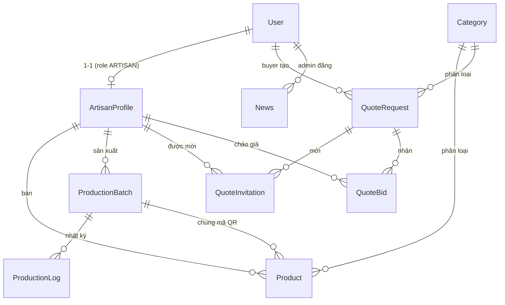
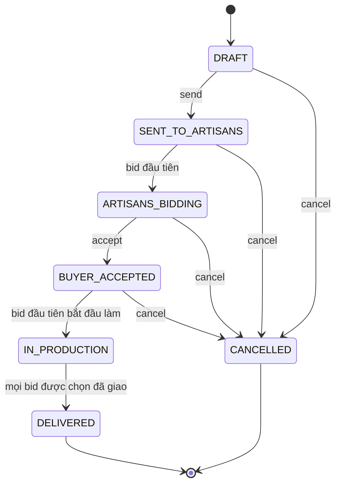
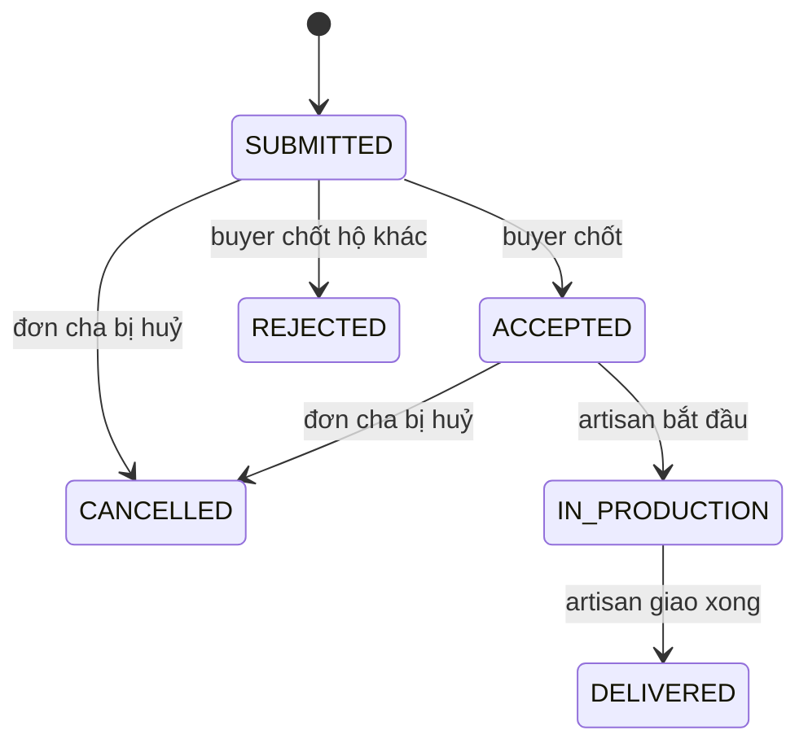

# 02. Thiết kế Cơ sở dữ liệu (Prisma Schema & State Machines)

Sử dụng Prisma ORM (ghim **Prisma 6**) giúp thao tác CSDL theo hướng đối tượng, mọi truy cập đi qua Prisma Client. **Dự án chạy trên PostgreSQL.** Đổi sang MySQL cần chỉnh thêm: MySQL không cho giá trị mặc định trên cột `Json` (bỏ `@default("[]")` và luôn gán `[]` ở service), và tìm kiếm không dùng `mode: 'insensitive'`. Vì vậy chỉ nói "độc lập CSDL" ở mức ORM, không hứa đổi `provider` là chạy ngay.

## 1. Sơ đồ quan hệ tổng quan



Giải thích ngắn:

* `User` 1–1 `ArtisanProfile` (chỉ tạo với `role = ARTISAN`).
* Nhiều `Product` cùng một `ProductionBatch` dùng chung `batchId` → dùng chung **một mã QR**.
* `QuoteRequest` 1–N `QuoteInvitation` (hộ được mời) và 1–N `QuoteBid` (chào giá). **`QuoteRequest` là gốc khoá (aggregate root)**: mọi thao tác ghi vào bid đều đi qua việc tăng `version` của đơn cha.

## 2. File `backend/prisma/schema.prisma`

```prisma
generator client {
  provider = "prisma-client-js"
}

datasource db {
  provider = "postgresql"
  url      = env("DATABASE_URL")
}

enum Role {
  ADMIN
  ARTISAN
  BUYER
}

enum UserStatus {
  PENDING    // Hộ gia đình vừa đăng ký, chờ Ban quản lý duyệt
  ACTIVE     // Đang hoạt động bình thường
  SUSPENDED  // Bị khoá (chặn ngay ở auth.middleware)
}

enum QuoteStatus {
  DRAFT
  SENT_TO_ARTISANS
  ARTISANS_BIDDING
  BUYER_ACCEPTED
  IN_PRODUCTION
  DELIVERED
  CANCELLED
}

enum BidStatus {
  SUBMITTED
  ACCEPTED
  REJECTED
  IN_PRODUCTION
  DELIVERED
  CANCELLED  // Tự gán khi Buyer/Admin huỷ QuoteRequest trước khi IN_PRODUCTION
}

enum NewsCategory {
  MATERIAL_PRICE // Giá nguyên vật liệu
  POWER_OUTAGE   // Lịch cúp điện
  SUPPORT_POLICY // Chính sách hỗ trợ
  GENERAL        // Tin chung
}

model User {
  id             Int             @id @default(autoincrement())
  email          String          @unique
  passwordHash   String
  fullName       String
  phone          String?
  role           Role            @default(BUYER)
  status         UserStatus      @default(ACTIVE)
  createdAt      DateTime        @default(now())
  updatedAt      DateTime        @updatedAt

  artisanProfile ArtisanProfile?
  quoteRequests  QuoteRequest[]
  newsPosts      News[]

  @@index([role, status])
}

model ArtisanProfile {
  id             Int               @id @default(autoincrement())
  userId         Int               @unique
  user           User              @relation(fields: [userId], references: [id], onDelete: Cascade)
  shopName       String
  slug           String            @unique
  familyHistory  String?           @db.Text
  craftSpecialty String?           // VD: Gốm men lam, Gốm đất nung
  address        String?
  latitude       Float?
  longitude      Float?
  isOpenForVisit Boolean           @default(false)
  openingHours   String?           // VD: "08:00 - 17:30"
  coverImage     String?           // URL bản full (/uploads/full/<uuid>.webp); thumb suy ra bằng thumbOf()
  galleryImages  Json              @default("[]") // [{ url, thumbnailUrl }]
  certificates   Json              @default("[]") // [{ title, issuer, imageUrl }]
  verifiedAt     DateTime?
  createdAt      DateTime          @default(now())
  updatedAt      DateTime          @updatedAt

  products       Product[]
  batches        ProductionBatch[]
  invitations    QuoteInvitation[]
  bids           QuoteBid[]

  @@index([isOpenForVisit])
}

model Category {
  id            Int            @id @default(autoincrement())
  name          String         @unique
  slug          String         @unique
  description   String?
  products      Product[]
  quoteRequests QuoteRequest[]
}

model ProductionBatch {
  id            Int             @id @default(autoincrement())
  artisanId     Int
  artisan       ArtisanProfile  @relation(fields: [artisanId], references: [id], onDelete: Cascade)
  batchCode     String          @unique // VD: VCRAFT-K7Q2M9XB (8 ký tự ngẫu nhiên, dùng sinh QR động)
  title         String
  story         String?         @db.Text
  startDate     DateTime
  completedDate DateTime?
  createdAt     DateTime        @default(now())

  logs          ProductionLog[]
  products      Product[]

  @@index([artisanId])
}

model ProductionLog {
  id           Int             @id @default(autoincrement())
  batchId      Int
  batch        ProductionBatch @relation(fields: [batchId], references: [id], onDelete: Cascade)
  stepOrder    Int
  stageName    String          // VD: Nhào đất, Vuốt gốm, Nung lò, Thành phẩm
  description  String?         @db.Text
  loggedAt     DateTime        @default(now())
  imageUrl     String?         // URL bản full (/uploads/full/<uuid>.webp)
  thumbnailUrl String?         // Server tự tính = imageUrl ? thumbOf(imageUrl) : null

  @@unique([batchId, stepOrder]) // Không trùng thứ tự trong một lô (trùng → 409)
}

model Product {
  id          Int              @id @default(autoincrement())
  artisanId   Int
  artisan     ArtisanProfile   @relation(fields: [artisanId], references: [id], onDelete: Cascade)
  categoryId  Int
  category    Category         @relation(fields: [categoryId], references: [id])
  batchId     Int?             // Nhiều sản phẩm dùng chung 1 batchId -> chung mã QR
  batch       ProductionBatch? @relation(fields: [batchId], references: [id], onDelete: SetNull)
  name        String
  slug        String           @unique
  price       Int              // VND, tối đa 2.000.000.000 (Zod chặn)
  description String?          @db.Text
  images      Json             @default("[]") // [{ url, thumbnailUrl }]
  isUnique    Boolean          @default(false) // Sản phẩm độc bản
  isActive    Boolean          @default(true)  // false = đã ẩn
  createdAt   DateTime         @default(now())
  updatedAt   DateTime         @updatedAt

  @@index([artisanId, isActive])
  @@index([categoryId, isActive])
}

model QuoteRequest {
  id               Int               @id @default(autoincrement())
  buyerId          Int
  buyer            User              @relation(fields: [buyerId], references: [id])
  categoryId       Int?
  category         Category?         @relation(fields: [categoryId], references: [id])
  title            String            // VD: Đặt 5.000 cốc in logo Trường ĐH Công nghệ
  description      String            @db.Text
  totalQuantity    Int
  targetBudget     Float?            // Ngân sách gợi ý (VND), tối đa 1.000.000.000.000 (Zod chặn), không dùng tính toán
  deliveryDeadline DateTime          // Hạn giao hàng người mua mong muốn
  status           QuoteStatus       @default(DRAFT)
  version          Int               @default(0) // Khoá lạc quan: mọi thao tác ghi liên quan đơn (kể cả bid) đều tăng
  createdAt        DateTime          @default(now())
  updatedAt        DateTime          @updatedAt

  invitations      QuoteInvitation[]
  bids             QuoteBid[]

  @@index([buyerId, status])
}

model QuoteInvitation {
  id             Int            @id @default(autoincrement())
  quoteRequestId Int
  quoteRequest   QuoteRequest   @relation(fields: [quoteRequestId], references: [id], onDelete: Cascade)
  artisanId      Int
  artisan        ArtisanProfile @relation(fields: [artisanId], references: [id], onDelete: Cascade)
  invitedAt      DateTime       @default(now())

  @@unique([quoteRequestId, artisanId])
}

model QuoteBid {
  id                      Int            @id @default(autoincrement())
  quoteRequestId          Int
  quoteRequest            QuoteRequest   @relation(fields: [quoteRequestId], references: [id], onDelete: Cascade)
  artisanId               Int
  artisan                 ArtisanProfile @relation(fields: [artisanId], references: [id], onDelete: Cascade)
  unitPrice               Int            // VND/sản phẩm
  offeredQuantity         Int            // Số lượng tối đa nghệ nhân nhận làm
  acceptedQuantity        Int?           // Số lượng thực tế được phân bổ (<= offeredQuantity)
  estimatedCompletionDate DateTime       // Ngày dự kiến hoàn thành nghệ nhân cam kết
  note                    String?        @db.Text
  status                  BidStatus      @default(SUBMITTED)
  createdAt               DateTime       @default(now())
  updatedAt               DateTime       @updatedAt

  @@unique([quoteRequestId, artisanId]) // Mỗi hộ một chào giá cho mỗi đơn
}

model News {
  id          Int          @id @default(autoincrement())
  authorId    Int
  author      User         @relation(fields: [authorId], references: [id])
  title       String
  slug        String       @unique
  category    NewsCategory @default(GENERAL)
  content     String       @db.Text
  imageUrl    String?      // URL bản full (/uploads/full/<uuid>.webp); thumb suy ra bằng thumbOf()
  publishedAt DateTime     @default(now())
  createdAt   DateTime     @default(now())
  updatedAt   DateTime     @updatedAt

  @@index([category, publishedAt])
}
```

**Lưu ý khi viết code:**

* `Int` trong PostgreSQL tối đa `2.147.483.647`; Zod phải chặn `price`, `unitPrice` ≤ `2_000_000_000`, và `targetBudget` ≤ `1_000_000_000_000`. Tổng tiền (`unitPrice × acceptedQuantity`) **không lưu**, tính bằng `number` của JavaScript khi cần.
* Bỏ qua `BigInt` vì `JSON.stringify` mặc định của Node không hỗ trợ.
* Mọi truy vấn trong `prisma.$transaction(async (tx) => ...)` phải dùng `tx`, không dùng `prisma` trần.

## 3. State Machine tách biệt (`src/modules/quotes/quote-state-machine.js`)

### 3.1. `QuoteStatus` (Đơn yêu cầu báo giá)



| Trạng thái hiện tại | Chuyển hợp lệ sang | Tác nhân / Điều kiện |
| :--- | :--- | :--- |
| `DRAFT` | `SENT_TO_ARTISANS`, `CANCELLED` | Buyer (chủ đơn) hoặc Admin. Chỉ sửa nội dung (`PUT /quotes/:id`) khi `DRAFT`. |
| `SENT_TO_ARTISANS` | `ARTISANS_BIDDING`, `CANCELLED` | Tự chuyển khi có bid hợp lệ đầu tiên; Buyer/Admin có thể huỷ. |
| `ARTISANS_BIDDING` | `BUYER_ACCEPTED`, `CANCELLED` | Buyer/Admin chốt phân bổ (`accept-quote.workflow.js`) hoặc huỷ. |
| `BUYER_ACCEPTED` | `IN_PRODUCTION`, `CANCELLED` | Tự chuyển khi bid đầu tiên bắt đầu làm; nếu huỷ → mọi bid `ACCEPTED` thành `CANCELLED` (bid `REJECTED` giữ nguyên). |
| `IN_PRODUCTION` | `DELIVERED` | Tự chuyển khi **100% bid được chọn** đạt `DELIVERED`. **Không được huỷ.** |
| `DELIVERED`, `CANCELLED` | *(Kết thúc)* | Không đổi trạng thái nữa. |

**Chốt một phần là chủ ý:** `sum(acceptedQuantity) ≤ totalQuantity`, nghĩa là Buyer được chốt ít hơn số lượng yêu cầu. Giao diện phải hiển thị rõ "đã phân bổ X / yêu cầu Y". Đơn lên `DELIVERED` khi mọi bid **đã chọn** giao xong, phần chưa phân bổ coi như bị bỏ.

### 3.2. `BidStatus` (Chào giá của từng hộ)



| Trạng thái hiện tại | Chuyển hợp lệ sang | Tác nhân / Điều kiện |
| :--- | :--- | :--- |
| `SUBMITTED` | `ACCEPTED`, `REJECTED`, `CANCELLED` | `ACCEPTED` (gán `acceptedQuantity`) hoặc `REJECTED` khi Buyer chốt; `CANCELLED` nếu đơn cha bị huỷ. Chỉ bid `SUBMITTED` mới sửa được. |
| `ACCEPTED` | `IN_PRODUCTION`, `CANCELLED` | Artisan chủ bid bấm bắt đầu (đơn cha ở `BUYER_ACCEPTED` hoặc `IN_PRODUCTION`); `CANCELLED` nếu đơn cha bị huỷ trước sản xuất. |
| `IN_PRODUCTION` | `DELIVERED` | Artisan chủ bid xác nhận giao xong. |
| `REJECTED`, `DELIVERED`, `CANCELLED` | *(Kết thúc)* | Khoá cứng. |

## 4. Ma trận xử lý đồng thời

Mọi tình huống dưới đây đều giải quyết bằng một mẫu: **mở đầu transaction bằng `updateMany` có điều kiện trên `QuoteRequest` và tăng `version`**, sau đó mới đọc/ghi các bảng còn lại (chi tiết code ở `01-architecture.md` mục 3).

| Tình huống | Hậu quả nếu không khoá | Kết quả khi có khoá |
| :--- | :--- | :--- |
| Buyer chốt trong lúc hộ sửa giá | Chốt giá cũ | Hộ sửa trước → `version` tăng → Buyer nhận `409` và tải lại |
| Hai tab của Buyer cùng bấm chốt | Phân bổ trùng | Một thành công, một `409` |
| Buyer sửa nháp song song bấm gửi | Ghi đè đơn đã gửi | `PUT` dùng `updateMany` kèm `status: 'DRAFT'`; một bên thắng, bên kia `409` |
| Hộ B gửi bid đúng lúc Buyer chốt | Bid `SUBMITTED` lọt vào đơn đã `BUYER_ACCEPTED` | Bid bị từ chối vì điều kiện trạng thái trong `updateMany` |
| Buyer huỷ đúng lúc hộ bấm bắt đầu | Hộ làm trên đơn đã huỷ | Một bên thắng, bên kia `409` |
| Hai hộ cùng bấm giao phần cuối | Đơn không lên `DELIVERED` hoặc lên hai lần | Tuần tự hoá bằng khoá hàng; transaction thứ hai thấy đủ bid đã giao |
